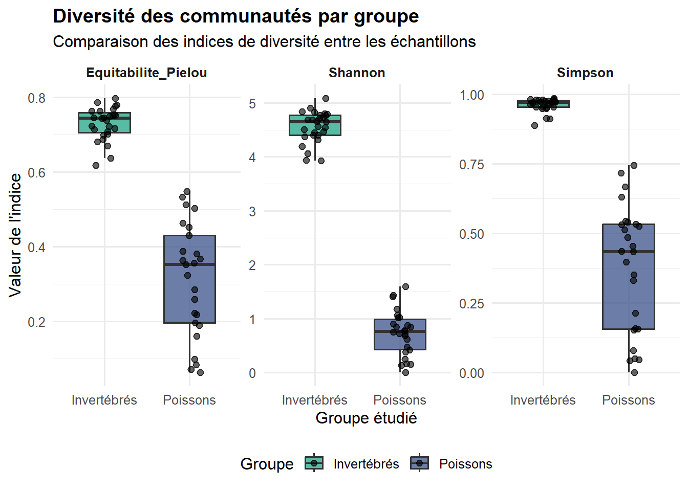
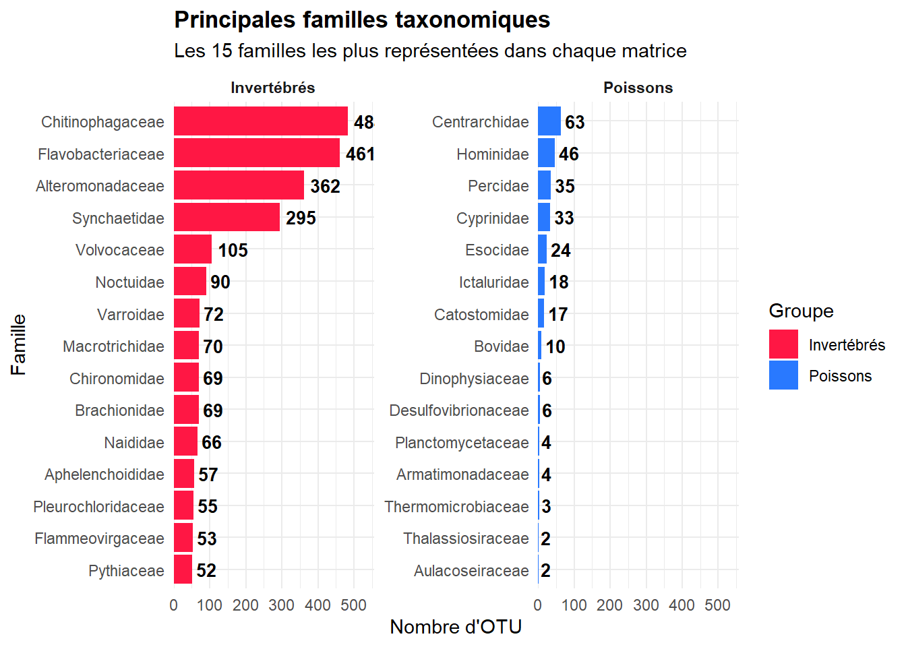
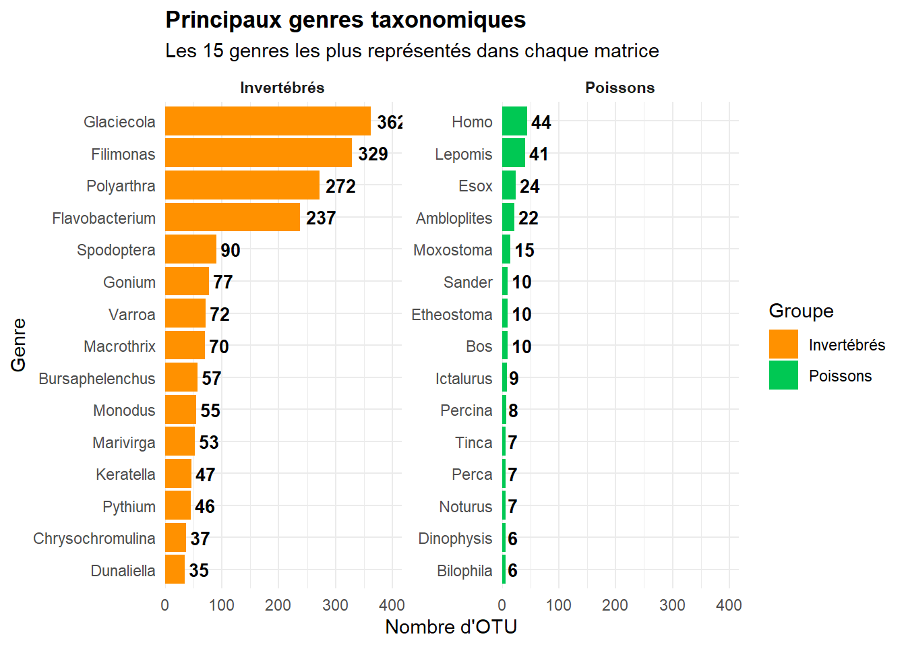
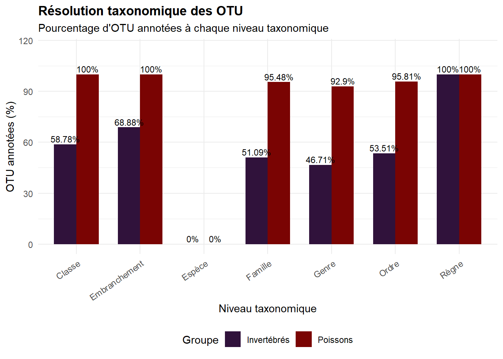
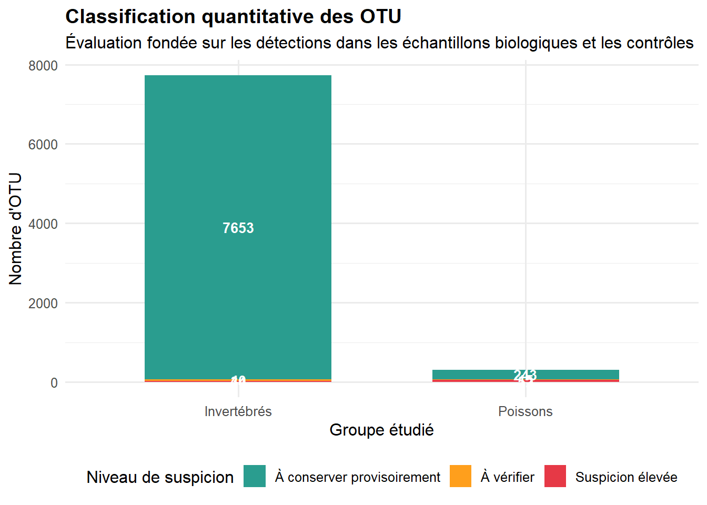
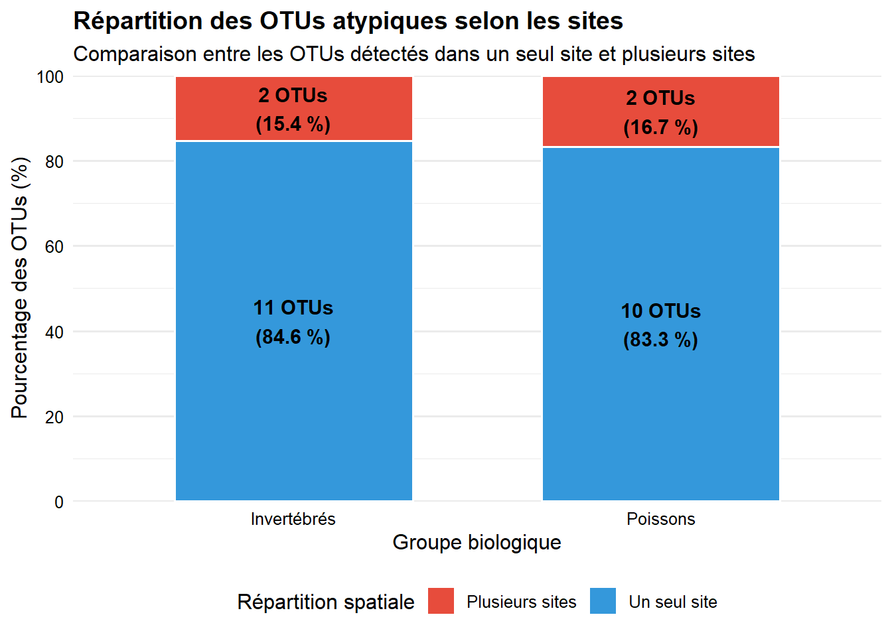
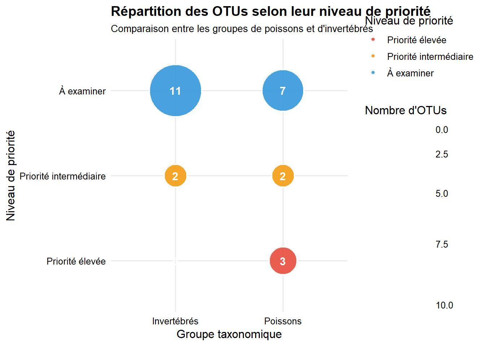

```{r setup, include=FALSE}
knitr::opts_chunk$set(echo=FALSE, warning=FALSE, message=FALSE, fig.align='center', fig.pos='H', out.width='95%')
```


```{r cartes-statiques, include=FALSE}
# Captures des widgets Leaflet originaux, sans reconstruire les cartes.
# Si webshot2 ou Chrome est absent, les captures de secours sont utilisées.
carte_originale <- function(i) {
  secours <- sprintf("figures_originales/carte_%d.png", i)
  cible <- sprintf("figures_originales/carte_pdf_%d.png", i)
  ids <- c("htmlwidget-c7b4390bb7ff45f906bf", "htmlwidget-d0683be2cfecbd11183b", "htmlwidget-35a0b50482b0b7265360", "htmlwidget-7391b48a27a062f86255", "htmlwidget-63f16227db2ec2a88f9d")
  if (requireNamespace("webshot2", quietly=TRUE)) {
    ok <- tryCatch({
      webshot2::webshot(normalizePath("rapport_original.html", winslash="/"), file=cible, selector=paste0("#", ids[i+1]), vwidth=1400, vheight=1000, delay=8, zoom=2)
      file.exists(cible)
    }, error=function(e) FALSE)
    if (isTRUE(ok)) return(cible)
  }
  secours
}
```

\begin{titlepage}
\begin{flushright}
\IfFileExists{images/Logo_SDA_png.jpeg}{\includegraphics[width=4.5cm]{images/Logo_SDA_png.jpeg}}{\IfFileExists{../images/Logo_SDA_png.jpeg}{\includegraphics[width=4.5cm]{../images/Logo_SDA_png.jpeg}}{}}
\end{flushright}
\begin{center}
\large Programme de formation en Science des Données au Féminin en Afrique Francophone
\vspace{1.5cm}

\textbf{RAPPORT DE FIN DE FORMATION}
\vspace{1cm}

{\LARGE\bfseries Biologie et données : une nouvelle lecture de la biodiversité\par}
\vspace{0.5cm}

Projet Génome Québec -- ADN environnemental

Version synthétique approfondie
\vspace{1cm}

Claudia D. TCHOBO, Jospine D. ABADASSI, Myrix MASSAMBA, Aïda T. SIGUE, Mireille MEGNIDIO
\vfill

Certification en Science des données -- Groupe 4

Comité d'organisation : Pr. Thierry WARIN, Dr. Bernice BANCOLE, Dr Josette-René LANDRY

Mars 2023 -- Novembre 2026
\end{center}
\end{titlepage}
\setcounter{page}{2}

# Thème du projet

Analyse de la biodiversité aquatique par ADN environnemental : caractérisation des poissons et des invertébrés au Québec.

# Contexte et justification du projet

La préservation de la biodiversité aquatique constitue un enjeu majeur pour la gestion durable des écosystèmes. Les méthodes conventionnelles d'inventaire présentent certaines limites liées aux difficultés d'échantillonnage et de détection des organismes. L'ADN environnemental (ADNe) constitue une approche complémentaire permettant de détecter les organismes à partir des traces génétiques présentes dans leur environnement.

Ce projet s'est inscrit dans le cadre de la Mission ADN-eau, une initiative de science citoyenne de Génome Québec qui a mobilisé des élèves d'écoles secondaires et de collèges pour la collecte d'échantillons d'eau. L'exploitation de ces données a offert une opportunité d'appliquer les outils de la science des données à la caractérisation de la biodiversité aquatique, tout en examinant la fiabilité des détections moléculaires.

# Bref résumé du projet

Ce projet a porté sur l'analyse des données d'ADNe des poissons et des invertébrés au Québec. Les traitements réalisés sous R ont permis d'évaluer la qualité des données, de caractériser la diversité moléculaire et sa répartition spatiale, puis d'examiner les signaux potentiels de contamination. Les analyses ont identifié 25 unités taxonomiques opérationnelles (OTU) présentant des annotations atypiques et absentes des contrôles examinés. Les résultats ont souligné l'intérêt de l'ADNe pour la surveillance écologique ainsi que ses limites méthodologiques.

# Objectifs du projet

## Objectif général

Analyser les données d'ADNe des poissons et des invertébrés afin d'évaluer leur qualité, de caractériser les détections taxonomiques et d'examiner les signaux atypiques dans les échantillons et contrôles.

## Objectifs spécifiques

- **OS1 :** assurer la qualité et la fiabilité des données d'ADNe utilisées pour caractériser la biodiversité des poissons et des invertébrés.
- **OS2 :** caractériser la diversité taxonomique des poissons et des invertébrés et décrire sa répartition dans les sites d'échantillonnage.
- **OS3 :** évaluer les signaux potentiels de contamination et les détections taxonomiques atypiques afin d'identifier les OTU nécessitant des vérifications complémentaires.

# Méthodologie

## Collecte, traitement et analyse des données

**Collecte des données.** Les données exploitées ont été fournies dans le cadre de la Mission ADN-eau de Génome Québec. Elles ont résulté de prélèvements d'eau réalisés par des élèves dans différents cours d'eau du Québec, suivis d'analyses moléculaires. Quatre fichiers ont été exploités : deux matrices de comptage des OTU et deux fichiers de métadonnées associés aux poissons et aux invertébrés.

**Traitement des données.** Les traitements ont consisté à vérifier la structure des fichiers, la concordance des identifiants, les valeurs manquantes et la validité des comptages. Les matrices ont été restructurées et associées aux métadonnées. Les échantillons biologiques, les blancs de terrain et les blancs d'extraction ont été distingués. Les annotations taxonomiques et les coordonnées géographiques disponibles ont également été examinées.

**Analyse des données.** Les analyses ont porté sur les profondeurs de séquençage, la richesse en OTU, les indices de Shannon, Simpson et Pielou, les courbes de raréfaction et la composition taxonomique. La répartition spatiale des détections a été examinée. Les profils des contrôles négatifs et les annotations atypiques ont ensuite été analysés afin de hiérarchiser les OTU nécessitant une validation complémentaire.

## Outils et techniques de collecte de données

**Outils utilisés.** Le langage R et l'environnement RStudio ont été utilisés pour le traitement, l'analyse statistique et la visualisation des données. Les packages dplyr et tidyr ont facilité la manipulation des données, vegan a permis les analyses de diversité, tandis que ggplot2 et Leaflet ont servi aux représentations graphiques et cartographiques. RMarkdown et GitHub ont soutenu la documentation du projet.

**Techniques appliquées.** Les données ont été produites par séquençage d'amplicons d'ADN environnemental, regroupés en unités taxonomiques opérationnelles et associés à des annotations taxonomiques putatives. Leur exploitation a mobilisé des techniques de nettoyage, de restructuration, de jointure et d'analyse statistique descriptive. L'examen des fréquences de détection et des nombres de lectures dans les contrôles négatifs a permis de repérer les signaux à vérifier.

# Résultats

## Principales informations dérivées de l’analyse des données

### Qualité et fiabilité des données (OS1)

**Structure et préparation des données.** Les vérifications ont permis de caractériser les matrices de comptage, comprenant 7 727 OTU chez les invertébrés et 310 chez les poissons. Aucun comptage négatif ni doublon d’identifiant OTU n’a été relevé. Les identifiants des échantillons présents dans les matrices ont correspondu aux métadonnées. Certains échantillons du mapping, dont des blancs et l’échantillon biologique de poissons FLD0219, n’ont toutefois pas été retrouvés dans les matrices. Au total, 27 échantillons biologiques d’invertébrés et 26 de poissons ont été exploités.

| Indicateur | Invertébrés | Poissons |
|:---|---:|---:|
| OTU dans les matrices | 7 727 | 310 |
| Échantillons biologiques | 27 | 26 |
| Lectures minimales | 36 474 | 16 |
| Lectures maximales | 201 735 | 172 886 |

**Profondeur de séquençage.** Les nombres de lectures ont varié de 36 474 à 201 735 chez les invertébrés et de 16 à 172 886 chez les poissons. L’échantillon FLD0202 de poissons s’est distingué par seulement 16 lectures, alors que les autres ont dépassé 1 000 lectures. Cette situation a nécessité une interprétation prudente de sa richesse moléculaire.

```{r fig-lectures, fig.cap="Abondances biologiques par site — graphique original.", out.width="90%"}
knitr::include_graphics("figures_originales/lectures.png")
```

Les traitements ont ainsi permis de constituer une base exploitable pour les analyses descriptives, tout en identifiant les contraintes de qualité et de couverture moléculaire.

### Diversité taxonomique et répartition spatiale (OS2)

**Richesse moléculaire observée.** La richesse a varié de 330 à 681 OTU chez les invertébrés, avec une moyenne de 528,44, et de 1 à 24 chez les poissons, avec une moyenne de 12,31. Ces résultats ont révélé une hétérogénéité des profils moléculaires entre prélèvements. L’échantillon FLD0202 n’a présenté qu’une seule OTU.

```{r fig-richesse, fig.cap="Richesse en OTU par échantillon biologique.", out.width="90%"}
knitr::include_graphics("figures_originales/richesse.png")
```

**Exhaustivité des détections.** Plusieurs courbes de raréfaction des invertébrés ont présenté une tendance à la stabilisation. Chez les poissons, la majorité des courbes ont continué à progresser sans plateau clairement identifiable. Ces observations ont suggéré qu’un effort supplémentaire de séquençage pourrait permettre de détecter d’autres OTU.

```{r fig-rarefaction, fig.cap="Courbes de raréfaction des échantillons biologiques.", out.width="90%"}
knitr::include_graphics("figures_originales/rarefaction.png")
```

**Diversité et équitabilité.** Les indices ont complété la richesse en renseignant sur la répartition des lectures entre les OTU.

| Indicateur | Invertébrés | Poissons |
|:---|---:|---:|
| Richesse moyenne | 528,44 | 12,31 |
| Richesse médiane | 551 | 11 |
| Richesse minimale | 330 | 1 |
| Richesse maximale | 681 | 24 |
| Shannon moyen | 4,558 | 0,740 |
| Gini-Simpson moyen | 0,962 | 0,375 |
| Pielou moyen | 0,729 | 0,313 |

Les indices ont traduit une répartition relativement équilibrée des lectures chez les invertébrés et une dominance plus marquée de certaines OTU chez les poissons. L’équitabilité de Pielou n’a pas pu être calculée pour FLD0202, dont la richesse a été limitée à une OTU.

```{r fig-indices, fig.cap="Distribution des indices de diversité.", out.width="90%"}

```

**Composition et résolution taxonomiques.** Chez les invertébrés, les familles Chitinophagaceae (6,26 %), Flavobacteriaceae (5,97 %) et Alteromonadaceae (4,68 %) ont figuré parmi les annotations les plus représentées. Les principales annotations de genre ont concerné *Glaciecola*, *Filimonas*, *Polyarthra* et *Flavobacterium*. Chez les poissons, les familles Centrarchidae (20,3 %), Hominidae (14,8 %) et Percidae (11,3 %) ont été les plus représentées. Les genres *Homo* (14,2 %), *Lepomis* (13,2 %), *Esox* (7,74 %) et *Ambloplites* (7,10 %) ont occupé les premières positions. Les annotations bactériennes, algales et mammaliennes ont montré que les affiliations ne se sont pas limitées aux groupes ciblés.

```{r fig-familles, fig.cap="Composition taxonomique : principales familles.", out.width="90%"}

```

```{r fig-genres, fig.cap="Composition taxonomique : principaux genres.", out.width="90%"}

```

La résolution taxonomique a atteint 91 % au niveau de la famille et 87,1 % au niveau du genre chez les poissons, contre 48,8 % et 44,4 % chez les invertébrés. Ces résultats ont souligné la nécessité de considérer le niveau réellement atteint par les annotations.

```{r fig-resolution, fig.cap="Comparaison de la résolution taxonomique.", out.width="90%"}

```

**Répartition spatiale.** Les représentations cartographiques ont mis en évidence une variabilité spatiale des profils de détection. Le faible nombre de réplicats par site a limité la portée des comparaisons écologiques. La carte superposée a permis de localiser les sites des deux groupes.

```{r carte-2, fig.cap="Cartographie originale superposée des sites d’échantillonnage.", out.width="90%"}
knitr::include_graphics(carte_originale(2))
```

Les analyses ont ainsi permis de caractériser la diversité moléculaire et sa distribution, sans assimiler les différences entre marqueurs à des différences de biodiversité réelle.

### Signaux potentiels de contamination et détections atypiques (OS3)

**Contrôles négatifs.** L’examen des blancs de terrain et d’extraction a révélé des détections nécessitant des vérifications. Les nombres de lectures et les fréquences de détection ont servi à distinguer les profils de suspicion. Dans la matrice des poissons, 54 OTU ont été assignées aux genres *Homo* et *Bos*, appartenant aux mammifères. Ces annotations ont nécessité de distinguer les contaminations potentielles, les amplifications non spécifiques et les erreurs éventuelles d’assignation.

```{r fig-controles, fig.cap="Classification quantitative originale des signaux associés aux contrôles.", out.width="90%"}

```

**OTU atypiques absentes des contrôles.** L’analyse a identifié 25 OTU atypiques, dont 13 chez les invertébrés et 12 chez les poissons. Chez les invertébrés, neuf ont été associées à *Bosmina* et les autres ont présenté des annotations correspondant notamment à *Bos*, *Ondatra*, *Felis* et *Lobosphaera*. Chez les poissons, les annotations ont principalement concerné *Bos* et *Homo*. Aucune des 25 OTU n’a obtenu une identification au niveau de l’espèce.

**Distribution spatiale.** Onze des 13 OTU atypiques d’invertébrés et dix des 12 OTU de poissons ont été détectées dans un seul site. Les OTU 1301 et 1330 chez les invertébrés et 291 et 296 chez les poissons ont été retrouvées dans plusieurs sites.

```{r fig-sites_atypiques, fig.cap="Répartition des OTU atypiques selon le nombre de sites.", out.width="90%"}

```

```{r carte-3, fig.cap="Carte originale des OTU atypiques chez les invertébrés.", out.width="90%"}
knitr::include_graphics(carte_originale(3))
```

```{r carte-4, fig.cap="Carte originale des OTU atypiques chez les poissons.", out.width="90%"}
knitr::include_graphics(carte_originale(4))
```

**Hiérarchisation.** Les critères exploratoires ont distingué trois niveaux : au moins 1 000 lectures (priorité élevée), sinon au moins deux sites (priorité intermédiaire), et les autres situations (à examiner).

| Priorité | Invertébrés | Poissons | Total |
|:---|---:|---:|---:|
| Élevée | 0 | 3 | 3 |
| Intermédiaire | 2 | 2 | 4 |
| À examiner | 11 | 7 | 18 |
| Total | 13 | 12 | 25 |

| OTU de poissons prioritaires | Lectures |
|:---|---:|
| 21 | 62 040 |
| 33 | 22 788 |
| 57 | 2 048 |

Les trois OTU de priorité élevée ont présenté des nombres de lectures justifiant une vérification prioritaire de leurs séquences. Les quatre OTU de priorité intermédiaire ont été retenues pour leurs détections dans plusieurs sites. Les 18 autres ont présenté moins de 1 000 lectures et une détection limitée à un site.

```{r fig-priorites, fig.cap="Répartition originale des OTU selon leur niveau de priorité.", out.width="90%"}

```

Cette hiérarchisation a fourni une base exploratoire pour orienter les investigations complémentaires, sans constituer une validation taxonomique.

## Format de présentation des résultats

Les résultats ont été présentés sous forme de tableaux, diagrammes, courbes de raréfaction et cartes interactives. Ces supports ont facilité la compréhension des variations de diversité moléculaire et des détections atypiques. Un rapport technique reproductible a été élaboré au format HTML. La présente synthèse a privilégié les résultats essentiels et les figures originales ; les cartes interactives ont été converties en images statiques pour le PDF.

# Discussion générale, conclusion et perspectives

## Discussion générale et limites méthodologiques

L’exploitation des données d’ADNe a souligné l’intérêt de combiner les analyses de diversité, de composition taxonomique et de distribution spatiale avec un examen de la qualité des données. La variabilité spatiale des détections a présenté une convergence descriptive avec les travaux de Berger et al. (2020) dans le fleuve Saint-Laurent. Toutefois, le faible nombre de réplicats et l’absence de paramètres environnementaux suffisamment documentés ont limité l’étude des facteurs associés à ces variations.

Les détections dans les contrôles négatifs ont également souligné l’importance des procédures de contrôle qualité, en accord avec les observations de Larson et al. (2022) en Alaska. La présence de lectures dans les blancs n’a pas constitué une preuve systématique de contamination, et leur absence n’a pas confirmé l’authenticité des détections atypiques.

L’hétérogénéité des profondeurs de séquençage a limité l’exhaustivité des détections pour certains échantillons. Les différences de marqueurs et de protocoles n’ont pas permis de comparer directement la biodiversité réelle des deux groupes. Les nombres de lectures n’ont pas constitué une mesure directe de l’abondance des organismes et les OTU n’ont pas nécessairement correspondu à des espèces distinctes.

L’absence d’identification au niveau de l’espèce pour les 25 OTU atypiques et le caractère exploratoire des seuils de hiérarchisation ont limité les conclusions taxonomiques. Les limites de résolution ont rejoint les enjeux étudiés par Morey et al. (2024). Les résultats ont donc constitué une première caractérisation descriptive et une base pour orienter les validations ultérieures.

## Conclusion générale

Cette étude a permis d’évaluer la qualité des données d’ADNe, de caractériser la diversité moléculaire des poissons et des invertébrés et d’examiner les signaux potentiels de contamination. Les analyses ont révélé une hétérogénéité des profondeurs de séquençage, de la richesse, de la composition taxonomique et des détections spatiales. Elles ont identifié 25 OTU atypiques absentes des contrôles, dont trois classées en priorité élevée. Les résultats ont souligné le potentiel de l’ADNe pour la surveillance aquatique, sous réserve de renforcer les validations moléculaires et taxonomiques.

## Impact sociétal et recommandations politiques

Ce projet a illustré l’intérêt de la science citoyenne et de la science des données pour la production de connaissances environnementales. L’exploitation des données d’ADNe a contribué à valoriser les informations collectées dans le cadre d’une initiative participative et à renforcer leur potentiel d’utilisation pour la surveillance des écosystèmes aquatiques.

Il est recommandé de promouvoir l’intégration progressive de l’ADNe aux dispositifs de surveillance écologique, en complément des méthodes conventionnelles. Cette intégration devra s’accompagner d’une harmonisation des protocoles de collecte et de contrôle qualité, du renforcement des bases de référence taxonomiques et de mécanismes de partage des données. Le soutien aux programmes de science citoyenne et à la formation des acteurs environnementaux pourrait favoriser l’appropriation de ces connaissances dans les processus de décision.

## Orientations scientifiques futures

Les investigations futures devront privilégier la validation moléculaire des OTU atypiques, notamment celles classées en priorité élevée, l’augmentation du nombre de réplicats biologiques et temporels ainsi que l’amélioration des métadonnées environnementales.

Sous réserve d’un effectif d’échantillonnage suffisant et de la disponibilité de variables physico-chimiques, hydrologiques et spatiales pertinentes, l’application de méthodes d’apprentissage automatique, notamment la forêt aléatoire (Random Forest), pourrait permettre d’identifier les principaux facteurs associés aux variations de diversité moléculaire, d’examiner leurs relations non linéaires et de prédire la richesse en OTU dans de nouveaux sites. Une validation croisée spatiale et indépendante devra accompagner cette démarche afin de limiter les risques de surapprentissage et d’évaluer la capacité de généralisation des modèles.

Ces approches pourraient contribuer au développement d’outils prédictifs d’aide à la surveillance et à la gestion durable des écosystèmes aquatiques.

# Difficultés rencontrées et solutions employées

## Difficultés

L’analyse des données d’ADNe a présenté plusieurs difficultés méthodologiques et techniques. Des différences entre les identifiants des fichiers de métadonnées et ceux des matrices d’OTU ont nécessité des vérifications préalables. L’hétérogénéité des profondeurs de séquençage a également compliqué l’interprétation de la richesse moléculaire. Certaines coordonnées géographiques manquantes ont limité les représentations spatiales. Par ailleurs, la présence d’OTU dans les contrôles négatifs et l’identification de taxons atypiques ont soulevé des incertitudes concernant la fiabilité de certaines détections.

## Solutions

Pour répondre à ces difficultés, des procédures de vérification des identifiants, de nettoyage des données et de contrôle des valeurs manquantes ont été appliquées. Les analyses de diversité ont été interprétées en tenant compte des différences de profondeur de séquençage. Les données géographiques ont été vérifiées avant leur cartographie. Enfin, les détections dans les contrôles et les annotations taxonomiques atypiques ont été examinées séparément, puis les OTU concernées ont été hiérarchisées afin d’orienter les validations complémentaires.

# Note {-}

Les résultats ont reposé sur des détections moléculaires exploratoires. Ils n’ont constitué ni une confirmation définitive des espèces ni une estimation directe de leur abondance.

\clearpage

# Références bibliographiques {-}

- Berger, C. S., Hernandez, C., Laporte, M., Côté, G., Paradis, Y., Kameni T. M., N., Normandeau, E., & Bernatchez, L. (2020). Fine-scale environmental heterogeneity shapes fluvial fish communities as revealed by eDNA metabarcoding. *Environmental DNA, 2*(4), 647–666. <https://doi.org/10.1002/edn3.129>

- Larson, W. A., Barry, P., Dokai, W., Maselko, J., Olson, J., & Baetscher, D. (2022). Leveraging eDNA metabarcoding to characterize nearshore fish communities in Southeast Alaska: Do habitat and tide matter? *Environmental DNA*. <https://doi.org/10.1002/edn3.297>

- Morey, K. C., Myler, E., Hanner, R., & Tetreault, G. (2024). Taxonomic blind spots: A limitation of environmental DNA metabarcoding-based detection for Canadian freshwater fishes. *Environmental DNA, 6*, e70054. <https://doi.org/10.1002/edn3.70054>
