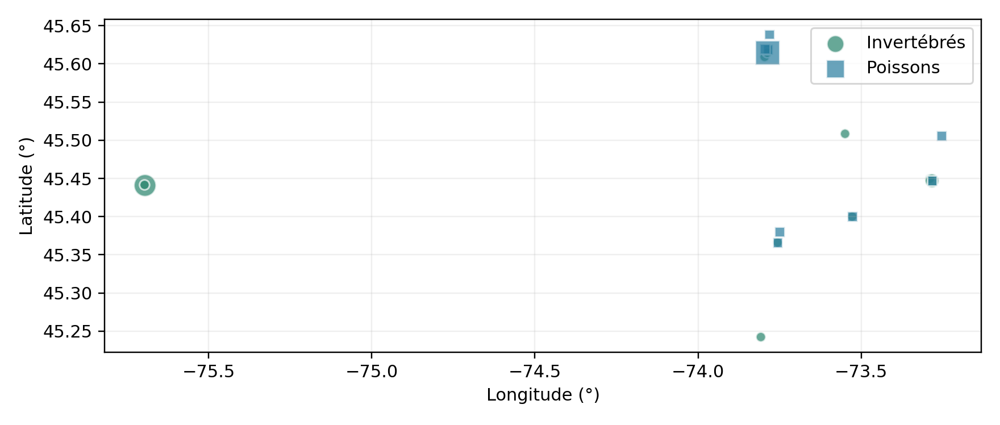
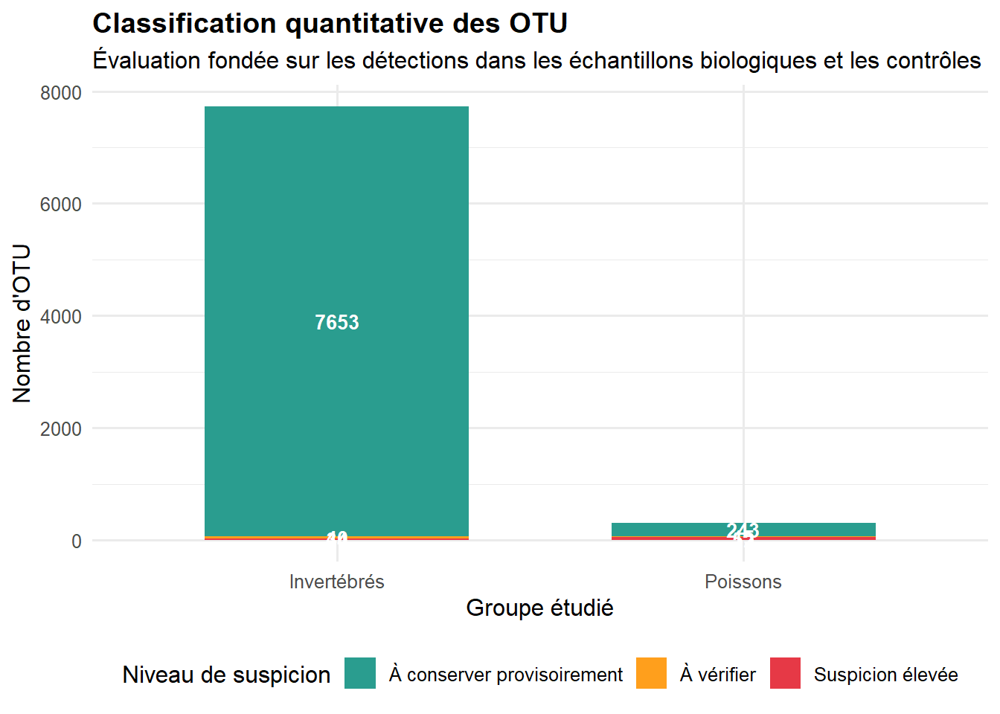
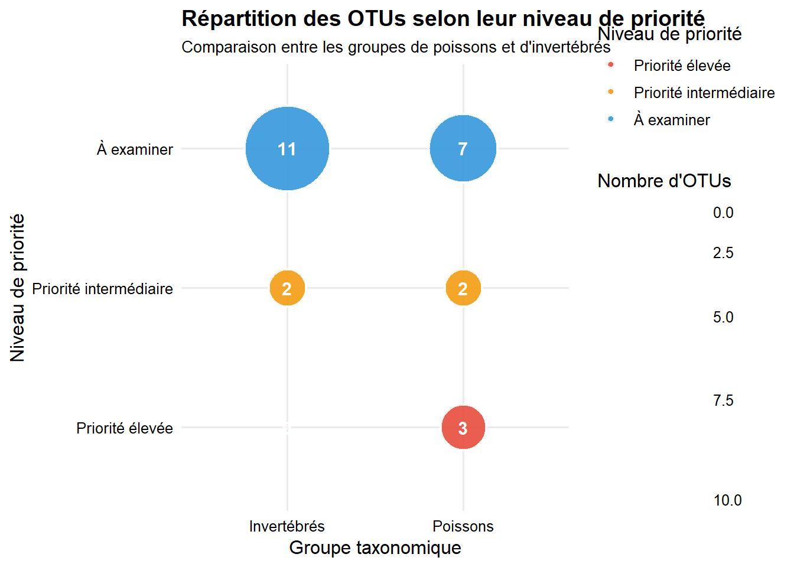

```{r setup, include=FALSE}
knitr::opts_chunk$set(echo=FALSE, warning=FALSE, message=FALSE, fig.align='center', fig.pos='H', out.width='95%')
```

\begin{titlepage}
\begin{flushright}
\IfFileExists{images/Logo_SDA_png.jpeg}{\includegraphics[width=4.5cm]{images/Logo_SDA_png.jpeg}}{}
\end{flushright}
\begin{center}
\large Programme de formation en Science des Données au Féminin en Afrique Francophone
\vspace{1.5cm}

\textbf{RAPPORT DE FIN DE FORMATION}
\vspace{1cm}

{\LARGE\bfseries Biologie et données : une nouvelle lecture de la biodiversité\par}
\vspace{0.5cm}

Projet Génome Québec -- ADN environnemental

Version synthétique
\vspace{1cm}

Claudia D. TCHOBO, Jospine D. ABADASSI, Myrix MASSAMBA, Aïda T. SIGUE, Mireille MEGNIDIO
\vfill

Certification en Science des données -- Groupe 4

Comité d'organisation : Pr. Thierry WARIN, Dr. Bernice BANCOLE, Dr Josette-René LANDRY

Mars 2023 -- Novembre 2026
\end{center}
\end{titlepage}
\setcounter{page}{1}

# Thème du projet

Analyse de la biodiversité aquatique par ADN environnemental : caractérisation des poissons et des invertébrés au Québec.

# Contexte et justification du projet

La préservation de la biodiversité aquatique constitue un enjeu majeur pour la gestion durable des écosystèmes. Les méthodes conventionnelles d'inventaire présentent certaines limites liées aux difficultés d'échantillonnage et de détection des organismes. L'ADN environnemental (ADNe) constitue une approche complémentaire permettant de détecter les organismes à partir des traces génétiques présentes dans leur environnement.

Ce projet s'est inscrit dans le cadre de la Mission ADN-eau, une initiative de science citoyenne de Génome Québec qui a mobilisé des élèves d'écoles secondaires et de collèges pour la collecte d'échantillons d'eau. L'exploitation de ces données a offert une opportunité d'appliquer les outils de la science des données à la caractérisation de la biodiversité aquatique, tout en examinant la fiabilité des détections moléculaires.

# Bref résumé du projet

Ce projet a porté sur l'analyse des données d'ADNe des poissons et des invertébrés au Québec. Les traitements réalisés sous R ont permis d'évaluer la qualité des données, de caractériser la diversité moléculaire et sa répartition spatiale, puis d'examiner les signaux potentiels de contamination. Les analyses ont identifié 25 unités taxonomiques opérationnelles (OTU) présentant des annotations atypiques et absentes des contrôles examinés. Les résultats ont souligné l'intérêt de l'ADNe pour la surveillance écologique ainsi que ses limites méthodologiques.

# Objectifs du projet

## Objectif général

Analyser les données d'ADNe des poissons et des invertébrés afin d'évaluer leur qualité, de caractériser les détections taxonomiques et d'examiner les signaux atypiques dans les échantillons et contrôles.

## Objectifs spécifiques

- **OS1 :** assurer la qualité et la fiabilité des données d'ADNe utilisées pour caractériser la biodiversité des poissons et des invertébrés.
- **OS2 :** caractériser la diversité taxonomique des poissons et des invertébrés et décrire sa répartition dans les sites d'échantillonnage.
- **OS3 :** évaluer les signaux potentiels de contamination et les détections taxonomiques atypiques afin d'identifier les OTU nécessitant des vérifications complémentaires.

# Méthodologie

## Collecte, traitement et analyse des données

**Collecte des données.** Les données exploitées ont été fournies dans le cadre de la Mission ADN-eau de Génome Québec. Elles ont résulté de prélèvements d'eau réalisés par des élèves dans différents cours d'eau du Québec, suivis d'analyses moléculaires. Quatre fichiers ont été exploités : deux matrices de comptage des OTU et deux fichiers de métadonnées associés aux poissons et aux invertébrés.

**Traitement des données.** Les traitements ont consisté à vérifier la structure des fichiers, la concordance des identifiants, les valeurs manquantes et la validité des comptages. Les matrices ont été restructurées et associées aux métadonnées. Les échantillons biologiques, les blancs de terrain et les blancs d'extraction ont été distingués. Les annotations taxonomiques et les coordonnées géographiques disponibles ont également été examinées.

**Analyse des données.** Les analyses ont porté sur les profondeurs de séquençage, la richesse en OTU, les indices de Shannon, Simpson et Pielou, les courbes de raréfaction et la composition taxonomique. La répartition spatiale des détections a été examinée. Les profils des contrôles négatifs et les annotations atypiques ont ensuite été analysés afin de hiérarchiser les OTU nécessitant une validation complémentaire.

## Outils et techniques de collecte de données

**Outils utilisés.** Le langage R et l'environnement RStudio ont été utilisés pour le traitement, l'analyse statistique et la visualisation des données. Les packages dplyr et tidyr ont facilité la manipulation des données, vegan a permis les analyses de diversité, tandis que ggplot2 et Leaflet ont servi aux représentations graphiques et cartographiques. RMarkdown et GitHub ont soutenu la documentation du projet.

**Techniques appliquées.** Les données ont été produites par séquençage d'amplicons d'ADN environnemental, regroupés en unités taxonomiques opérationnelles et associés à des annotations taxonomiques putatives. Leur exploitation a mobilisé des techniques de nettoyage, de restructuration, de jointure et d'analyse statistique descriptive. L'examen des fréquences de détection et des nombres de lectures dans les contrôles négatifs a permis de repérer les signaux à vérifier.

# Résultats

## Principales informations dérivées de l'analyse des données

**OS1.** Les analyses ont porté sur 27 échantillons biologiques d'invertébrés et 26 de poissons. Les profondeurs de séquençage ont varié fortement, avec un échantillon de poissons limité à 16 lectures. Larson et al. (2022) ont également souligné les enjeux méthodologiques du métabarcoding.

**OS2.** La richesse moyenne a atteint 528,44 OTU chez les invertébrés et 12,31 chez les poissons. Les variations spatiales ont rejoint descriptivement les observations de Berger et al. (2020). Les courbes de raréfaction ont suggéré une caractérisation encore incomplète de certains échantillons.

**OS3.** L'examen des contrôles a révélé des signaux à vérifier. Parmi les 25 OTU atypiques absentes des contrôles, 13 ont concerné les invertébrés et 12 les poissons. Trois OTU de poissons (21, 33 et 57) ont été classées en priorité élevée. Ces incertitudes ont rejoint les limites taxonomiques étudiées par Morey et al. (2024).

| Indicateur | Invertébrés | Poissons |
|:---|---:|---:|
| OTU dans les matrices | 7 727 | 310 |
| Échantillons biologiques | 27 | 26 |
| Lectures minimales | 36 474 | 16 |
| Lectures maximales | 201 735 | 172 886 |
| Richesse minimale | 330 | 1 |
| Richesse maximale | 681 | 24 |
| Richesse moyenne | 528,44 | 12,31 |
| OTU atypiques absentes des contrôles | 13 | 12 |
| Priorité élevée | 0 | 3 |

*Les marqueurs et protocoles différents ne permettent pas une comparaison biologique directe des deux groupes.*

## Format de présentation des résultats

Les résultats ont été présentés sous forme de tableaux statistiques, de diagrammes, de courbes de raréfaction et de cartes interactives. Ces supports ont facilité l'identification des variations de richesse moléculaire et des détections atypiques. Un rapport technique reproductible a été élaboré avec RMarkdown au format HTML. La présente synthèse a retenu six illustrations essentielles pour faciliter la communication des résultats.

\clearpage

```{r profondeur, fig.width=7, fig.height=2.5, fig.cap='OS1 — Étendue des profondeurs de séquençage et médianes (échelle logarithmique).'}
par(mar=c(4,8,1,1), las=1)
plot(c(16,201735),c(1,2),type='n',log='x',yaxt='n',ylab='',xlab='Nombre de lectures',ylim=c(0.7,2.3))
axis(2,at=1:2,labels=c('Poissons','Invertébrés'),tick=FALSE)
segments(c(16,36474),1:2,c(172886,201735),1:2,lwd=4,col=c('#287C9E','#27836B'))
points(c(126864.5,142560),1:2,pch=19,cex=1.5)
```

```{r richesse, fig.cap='OS2 — Richesse en OTU par échantillon biologique et site.', out.width='90%'}
knitr::include_graphics('figures_synthese/richesse.png')
```

\clearpage

```{r rarefaction, fig.cap='OS2 — Courbes de raréfaction des échantillons biologiques.', out.width='95%'}
knitr::include_graphics('figures_synthese/rarefaction.png')
```

```{r spatial, fig.cap='OS3 — Localisation des détections atypiques par groupe (coordonnées GPS, sans fond cartographique).', out.width='95%'}

```

\clearpage

```{r controles, fig.cap='OS3 — Classification quantitative des signaux associés aux contrôles négatifs.', out.width='90%'}

```

```{r priorites, fig.cap='OS3 — Répartition des 25 OTU atypiques selon leur priorité de validation.', out.width='90%'}

```

\clearpage

# Conclusion et perspectives

## Impact sociétal et recommandations politiques

Cette étude a mis en évidence l'intérêt de l'ADNe pour la caractérisation et la surveillance de la biodiversité aquatique. Elle a illustré la contribution de la science citoyenne et de la science des données à la production de connaissances environnementales. L'examen conjoint des poissons, des invertébrés et des contrôles a permis de cibler les vérifications nécessaires. Toutefois, aucune des 25 OTU atypiques n'a été identifiée au niveau de l'espèce et leur classement est resté exploratoire. Les différences de protocoles et le faible nombre de réplicats ont limité les interprétations écologiques. Il est recommandé d'intégrer progressivement l'ADNe aux dispositifs de surveillance écologique, d'harmoniser les protocoles, de renforcer les bases taxonomiques et de soutenir les initiatives participatives.

## Orientations scientifiques futures

Les recherches futures devront privilégier la validation moléculaire des OTU atypiques, notamment celles classées en priorité élevée. L'augmentation du nombre de réplicats biologiques et temporels, l'amélioration des métadonnées et l'examen des échantillons faiblement séquencés permettront de renforcer la fiabilité des analyses. L'intégration de paramètres environnementaux pourrait faciliter l'étude des variations spatiales de diversité.

# Difficultés rencontrées et solutions employées

## Difficultés

Les principales difficultés ont concerné la concordance des identifiants entre les matrices d'OTU et les métadonnées, l'hétérogénéité des profondeurs de séquençage et l'absence de certaines coordonnées géographiques. La présence de détections dans les contrôles négatifs et les limites de résolution taxonomique ont également compliqué l'interprétation des résultats et l'identification des signaux atypiques.

## Solutions

Des procédures de vérification des identifiants, de nettoyage et de restructuration des données ont été appliquées. Les profondeurs de séquençage ont été prises en compte dans l'interprétation des indices de diversité. Les coordonnées disponibles ont été vérifiées avant leur cartographie. Enfin, les contrôles négatifs et les annotations atypiques ont été examinés séparément, puis les OTU concernées ont été hiérarchisées selon des critères exploratoires.

# Note {-}

Les résultats ont reposé sur des détections moléculaires exploratoires. Ils n'ont constitué ni une confirmation définitive des espèces ni une estimation directe de leur abondance.

\clearpage

# Références bibliographiques {-}

Berger, C. S., Hernandez, C., Laporte, M., Côté, G., Paradis, Y., Kameni T. M., N., Normandeau, E., & Bernatchez, L. (2020). Fine-scale environmental heterogeneity shapes fluvial fish communities as revealed by eDNA metabarcoding. *Environmental DNA, 2*(4), 647–666. <https://doi.org/10.1002/edn3.129>

Larson, W. A., Barry, P., Dokai, W., Maselko, J., Olson, J., & Baetscher, D. (2022). Leveraging eDNA metabarcoding to characterize nearshore fish communities in Southeast Alaska: Do habitat and tide matter? *Environmental DNA*. <https://doi.org/10.1002/edn3.297>

Morey, K. C., Myler, E., Hanner, R., & Tetreault, G. (2024). Taxonomic blind spots: A limitation of environmental DNA metabarcoding-based detection for Canadian freshwater fishes. *Environmental DNA, 6*, e70054. <https://doi.org/10.1002/edn3.70054>
